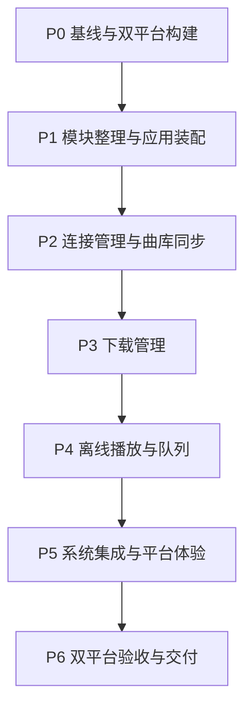

# Pikmelo Player 整体开发计划

更新日期为 2026-11-12。P0–P5 已完成，下一阶段为 P6。本文随实际开发结果更新。

## 1. 交付目标与范围

首期交付 Windows 与 Android 客户端。用户能够配置服务器和 API Key，同步获授权的歌单与曲目，选择曲目下载，在断网并重启应用后播放下载完成的音频。

开发以可维护的共享业务模块为基础，覆盖曲库浏览、下载管理、播放队列、基础系统媒体控制和平台生命周期处理。服务端协议沿用现有 Pikmelo Server API v2。

首期范围集中在已有服务器的客户端接入。服务器部署、曲库上传编辑、其他操作系统、Web、歌词特效和高级音效作为后续需求另行排期。

## 2. 计划建立时的起点

| 已有内容 | 当前情况 | 后续处理 |
|---|---|---|
| Flutter 工程 | 已生成 Windows 与 Android 工程 | 重新建立双平台构建基线 |
| `lib/protocol/pikmelo_api_client.dart` | 鉴权、同步请求、媒体下载与错误解析 | 复用协议实现，逐步收敛返回类型 |
| `lib/protocol/sync_page.dart` | 同步分页解析 | 保留分页语义，接入明确的数据模型 |
| `lib/data/sync_service.dart` | 分页、重启同步、缓存权限恢复 | 整理并发、凭据变化与生命周期入口 |
| `lib/data/local_library_store.dart` | SQLite、同步事务、下载与缓存记录 | 增加查询与迁移能力，保留旧数据 |
| `lib/data/media_download_service.dart` | 去重、Range/ETag 续传、完整文件发布 | 增加任务管理与界面接入 |
| `lib/data/api_key_store.dart` | 系统凭据存储封装 | 统一服务器身份，支持凭据更新 |
| `lib/main.dart` | 主题、连接表单、同步协调、歌单展示 | 提取应用装配、控制器和页面 |
| `test/protocol_core_test.dart` | 同步及媒体协议回归用例 | 随模块迁移维护原覆盖范围 |
| `test/widget_test.dart` | 手机与桌面布局检查 | 随页面调整维护 |

上述初始代码已在 P0 建立双平台构建基线，并在 P1 完成模块迁移。最新验证结果见各阶段执行记录。

## 3. 模块结构与职责

采用单个 Flutter 工程内的功能模块。以下路径是计划目标，按任务逐步建立。

| 模块 | 目标文件与职责 |
|---|---|
| 应用装配 | `lib/main.dart` 保留启动入口，`lib/app/pikmelo_app.dart` 管理主题与导航，`lib/app/app_dependencies.dart` 管理服务创建与释放 |
| 曲库 | `lib/library/models/track.dart`、`playlist.dart` 表达数据，`lib/library/library_repository.dart` 提供本地曲库读取，`lib/library/ui/library_page.dart`、`playlist_page.dart` 展示内容 |
| 同步 | `lib/sync/sync_service.dart` 协调分页与提交，`lib/sync/sync_controller.dart` 暴露状态和触发入口 |
| 下载 | `lib/downloads/media_download_service.dart` 处理单任务，`download_manager.dart` 管理队列与恢复，`models/download_task.dart` 表达任务状态，`ui/downloads_page.dart` 展示任务 |
| 播放 | `lib/playback/playback_engine.dart` 定义实际需要的后端接口，`playback_controller.dart` 管理状态和队列，`models/playback_state.dart` 表达播放状态，`ui/player_bar.dart` 展示播放控制 |
| 设置 | `lib/settings/models/server_connection.dart` 表达连接配置，`connection_controller.dart` 管理连接与同步状态，`ui/connection_card.dart` 提供连接表单，独立设置页随 P2 完善 |
| 基础设施 | `lib/infrastructure/server/pikmelo_api_client.dart`、`sync_page.dart` 封装服务器协议，`storage/local_library_store.dart` 管理数据库，`storage/api_key_store.dart` 管理凭据 |
| 平台集成 | `lib/infrastructure/playback/` 放置所选播放插件适配，`lib/infrastructure/platform/` 放置生命周期及系统媒体集成 |
| 共用界面 | `lib/shared/widgets/` 仅在出现实际复用时提取公共组件 |

模块内允许根据实际复杂度合并文件。独立 Dart package 的拆分在出现跨项目复用需求或独立发布需求时评估。

### 依赖与状态约定

- UI 调用功能控制器，控制器协调服务和仓库。协议与存储实现保持对页面的独立性。
- 曲库页面通过本地仓库读取数据。同步提交完成后刷新页面数据，启动时先加载本地内容。
- 播放队列、循环模式、音源选择与下载调度使用共享 Dart 实现。播放后端通过统一接口接入。
- SQLite 写入继续遵循整轮同步事务，保留 generation、完整文件发布和逐曲目授权检查语义。
- 服务器地址规范化逻辑统一复用 `LocalLibraryStore.serverKey`，凭据更新也进入同步上下文管理，防止旧请求结果应用到新连接。
- 控制器明确持有和释放网络、流订阅、播放器及数据库资源。同一同步上下文内串行执行同步，下载保留合理并发与去重。
- 现有 Material 3 作为初期界面基础，采用响应式布局复用组件。平台差异集中处理后台服务、音频焦点、系统控制、目录与权限。
- 状态管理、播放插件和具体并发数量作为实现选择，在对应阶段结合已有代码及双平台验证确定。

## 4. 实施顺序与任务依赖



主线按依赖顺序推进。播放后端的最小验证可在 P1 完成后提前进行，用于及早确认 Windows 与 Android 的解码和构建条件。需要协作时，可将独立的平台验证或只读复核单独分派，共享数据模型和数据库迁移保持统一负责人。

### P0 基线与双平台构建

- [x] P0.1 建立当前代码与工具链基线。
  - [x] 检查 Git 状态及已有产物，当前项目文件均未跟踪，存在 Windows 历史调试产物，尚无 Android APK。
  - [x] 读取当前工具配置，Flutter 3.47.9、Dart 3.13.7、Java 配置指向 JDK 21、Gradle 8.14.3、AGP 8.11.1、Kotlin 2.2.20，Android API 35。
  - [x] 重新运行静态分析与现有测试，两条命令退出码均为 0，静态分析无问题，13 项测试通过。
- [x] P0.2 恢复 Android 构建。
  - [x] 检查代理，原端口 7897 未监听，实际代理为 verge-mihomo 的 7890，通过 HTTP 代理请求 Android Maven 返回 200。
  - [x] 按实际错误恢复依赖下载或修正项目构建配置。
    - [x] 通过当前进程的 JAVA_TOOL_OPTIONS 使用 7890 代理，Android Gradle 插件依赖已成功缓存。
    - [x] 根据 flutter_secure_storage 编译要求，将 compileSdk 调整为 36；SDK 36 已安装，minSdk 24、targetSdk 35。
    - [x] 定位 sqlite3 原生 hook 直连 GitHub 的等待，补充本次进程的 HTTP_PROXY、HTTPS_PROXY 和 NO_PROXY，与 Java 代理一起传入重试构建。
    - [x] 使用调整后的配置重新验证 APK 构建，退出码为 0，最后一次构建耗时 170.3 秒。
  - [x] 生成 `build/app/outputs/flutter-apk/app-debug.apk`，大小 164401294 字节，包含默认目标 ABI。
- [x] P0.3 验证 Windows 构建与运行。
  - [x] 重新构建 Windows 调试版并核对产物，命令退出码为 0，构建耗时 33.3 秒。
  - [x] 后台启动应用，进程正常响应，Flutter 调试服务确认首页已构建且组件树无 ErrorWidget，启动日志无异常堆栈。本轮采用程序化启动检查，交互体验在后续平台验收中验证。
- [x] P0.4 验证 Android 运行。
  - [x] 检查设备环境，目前无已连接设备及 AVD，Android 35 x86_64 Google Play 镜像已安装，WHPX 加速可用。
  - [x] 使用现有镜像创建 Pikmelo_API_35 并后台启动，adb 识别 emulator-5554，sys.boot_completed 为 1，系统为 Android 15/API 35。
  - [x] APK 安装返回 Success，主 Activity 冷启动 Status 为 ok、TotalTime 为 6633 毫秒，前台 Activity 与进程正常，Flutter/AndroidRuntime 日志无异常，已检查首页截图。
- [x] P0.5 汇总基线。
  - [x] 记录工具版本、设备、检查结果及剩余限制，详见下方执行记录。
  - [x] 根据 SDK 与代理发现更新本阶段，并为 P1 增加构建依赖兼容性评估任务。

#### P0 执行记录

- Windows 调试构建通过，原生产物路径为 `build/windows/x64/runner/Debug/pikmelo_player.exe`。启动检查采用后台进程和 Flutter 调试服务，确认首页组件构建成功；鼠标键盘交互与视觉体验留待平台体验阶段验收。
- Android 使用新建的 Pikmelo_API_35 模拟器，Google Play x86_64 镜像，WHPX 加速。调试 APK 已安装启动，首页布局呈现正常。
- 实际 Java 为 Oracle JDK 21.0.8。Android 构建使用 compileSdk 36、targetSdk 35、minSdk 24；当前 NDK 为 28.2.13676358，构建自动补齐 CMake 3.22.1。
- 静态分析无问题，13 项测试通过。测试和构建命令退出码均为 0。
- 当前本机代理监听 7890。构建中分别为 Java 和 Dart 原生 hook 传入代理，设置仅作用于构建进程。执行命令见第五节。
- Flutter 对 Gradle 8.14.3、AGP 8.11.1、Kotlin 2.2.20 给出后续支持提示，已纳入 P1.5 评估。
- P0 验证范围为构建、启动与现有自动化用例。真实服务器联调、曲库迁移、下载操作和音频播放按后续阶段验收矩阵执行。

涉及 `pubspec.yaml`、`pubspec.lock`、`android/`、`windows/` 和现有测试，仅在定位到具体构建问题时修改配置。

验收要求为现有测试通过、静态分析通过、两个平台构建并启动成功。若 Android 受网络或设备条件影响，记录实际失败环节，继续推进可验证的公共模块，后续阶段持续跟进构建恢复。

### P1 模块整理与应用装配

- [x] P1.1 按第三节移动现有协议、存储、同步和下载文件，更新引用和测试导入。
  - [x] 迁移到 infrastructure、sync、downloads 目录，更新全部内部引用与现有测试。
  - [x] 保留原有公共方法签名和 main.dart 的应用类导出。
- [x] P1.2 从 `main.dart` 提取应用入口、主题、连接页面及业务协调，建立服务生命周期管理。
  - [x] 建立 AppDependencies，统一懒加载数据库、创建网络客户端及释放资源。
  - [x] 建立 ConnectionController，管理连接与同步状态，防止重复执行和销毁后回调。
  - [x] 提取 PikmeloPlayerApp、LibraryPage、ConnectionCard 和 PlaylistPanel，使用 ChangeNotifier 驱动界面。
- [x] P1.3 引入曲目、歌单和服务器连接模型，结合真实协议字段处理缺省值与旧数据库中的 JSON。
  - [x] 增加 Track、Playlist、ServerConnection，保留旧 JSON 与未知字段，统一服务器地址验证。
  - [x] 通过曲库仓库读取类型化数据，将下载元数据校验接入 Track。
- [x] P1.4 明确本地曲库读取接口和控制器状态，保留可测试的依赖注入入口。
  - [x] 使用现有表结构验证磁盘数据库重开后的类型化读取，包含曲目缺省字段、重复成员与不可用成员。
  - [x] 验证控制器正常连接、重复触发、异步销毁与客户端关闭，并验证界面连接入口。
  - [x] 格式检查、静态分析、25 项测试全部通过，Windows 与 Android 调试构建及启动检查通过。
- [x] P1.5 评估 Flutter 输出的 Gradle、AGP 与 Kotlin 后续支持提示，基于插件兼容性确定升级任务与回归范围。
  - [x] 对照 Flutter 本机校验与插件配置记录当前兼容性，确定独立升级任务 M1。

P1 实施选择采用 Flutter 自带 ChangeNotifier。连接与同步先由 ConnectionController 协调，独立 SyncController 随 P2 的多入口同步需求评估。当前数据库采用现有表结构，持久化协议继续保存完整 JSON，类型转换集中在业务读取边界。

执行中发现服务器键包含空 URI 组件的 `?#` 后缀，保留该历史格式以兼容旧数据库。回归测试另发现数据库同步打开失败的重试问题、异步凭据回填到已更换服务器的表单，以及短窗口布局溢出，已分别修正并加入用例。

#### P1 执行记录

- `main.dart` 现在负责绑定初始化与应用启动，并继续导出 PikmeloPlayerApp。AppDependencies 管理数据库与客户端的创建，应用持有 ConnectionController，页面通过 ListenableBuilder 订阅状态。
- LibraryPage 组合 ConnectionCard 和 PlaylistPanel。LibraryRepository 提供类型化曲库读取。同步提交与下载仍使用原有事务、generation 检查及完整文件发布逻辑。
- 数据库表结构和磁盘位置沿用现有实现。新增样本测试直接创建原有 tracks/playlists 表，验证缺省字段、未知字段、成员顺序、重复成员、不可用成员及数据库重开。
- 静态分析无问题，25 项测试通过。新增 12 项用例覆盖模型、数据库兼容、控制器生命周期、重复触发、认证失败、数据库打开重试、连接表单入口及延迟凭据回填。布局用例增加 800×600 窗口检查。
- Windows 调试构建通过，耗时 27.9 秒；后台启动进程正常响应，调试服务确认 LibraryPage、ConnectionCard 和 PlaylistPanel 均已构建，组件树无 ErrorWidget，启动日志无异常堆栈。
- Android 调试构建通过，耗时 23.5 秒；在 Pikmelo_API_35 上覆盖安装成功，冷启动 Status 为 ok，TotalTime 为 9156 毫秒，前台 Activity、首页截图与应用日志检查正常。
- 插件配置核实 flutter_secure_storage 使用 Flutter 的 compileSdk，并要求 minSdk 24；当前 compileSdk 36 与 minSdk 24 已构建验证。本机 Flutter DependencyVersionChecker 的最低 Gradle、AGP、Kotlin 版本分别为 8.14.0、8.11.1、2.2.20，当前配置达到最低要求；提示目标为 9.1.0、9.0.1、2.3.20，后续按 M1 联合升级验证。
- 连接集成测试使用可控客户端和内存凭据，旧数据库测试使用临时磁盘样本。真实 HTTPS 服务器联调继续按 P2/P6 执行。

主要修改第三节列出的 `app/`、`library/models/`、`settings/`、`sync/`、`infrastructure/` 和现有两个测试文件。

验收要求为现有连接、同步、下载与布局回归通过，旧数据库可打开，页面退出或连接切换后资源正确释放。数据库结构修改伴随版本迁移，使用已有数据库样本验证。

### P2 连接管理与曲库同步

- [x] P2.1 保存服务器选择和连接配置，使用系统凭据存储保存 API Key，启动后先显示本地曲库。
  - [x] 在现有 SQLite 增加应用设置与凭据作用域记录，保留旧表及缓存文件。
  - [x] 统一凭据键并兼容旧键，启动恢复服务器与本地曲库，再尝试联网同步。
- [x] P2.2 提供歌单详情和曲目列表，展示缺失曲目、可下载状态及同步状态。
  - [x] 由曲库仓库按成员顺序构建详情条目，保留重复及不可用成员。
  - [x] 接入详情页面、下载状态与本地数据提示。
- [x] P2.3 统一手动同步与前台恢复入口，处理重复触发、服务器或 Key 切换、旧请求完成时的状态检查。
  - [x] 添加共享刷新入口与前台恢复触发，相同上下文合并重复同步。
  - [x] 使用上下文版本与数据库 generation 检查阻止失效请求提交，串行保存连接配置。
- [x] P2.4 核对现有分页、reset、`SYNC_RESTART` 行为，补齐实际缺失的超时、429 与 `Retry-After` 处理。
  - [x] 为元数据请求和媒体权限检查添加超时、有限 429 重试及可取消等待。
  - [x] 验证分页中断回滚、增量恢复、重试等待和取消行为。
- [x] P2.5 验证权限撤销、同一服务器更换 Key、服务器切换及离线启动时的可见数据和缓存处理。
  - [x] 以凭据指纹隔离同一服务器的授权上下文，变化时清理旧可见快照并撤销缓存授权。
  - [x] 增加离线启动、切换竞态和权限变化回归测试，核实真实服务联调条件。
  - [x] 静态分析及 38 项测试通过，双平台调试构建及启动检查通过，记录限制并更新后续步骤。
  - [x] 使用用户确认的 Key 在真实 HTTPS 服务执行获授权歌单的只读同步联调。

#### P2 执行记录

- 新增 app_settings 和 server_credentials 表，通过 CREATE TABLE IF NOT EXISTS 兼容现有数据库。服务器选择持久化在本地，API Key 继续使用系统安全存储，数据库保存 SHA-256 凭据指纹。
- ApiKeyStore 统一使用原有服务器标识作为凭据键，并兼容原始地址及尾斜杠旧键。连接成功读取健康接口后迁移保存凭据；旧凭据对应的曲库可在离线启动时恢复。
- 更换同一服务器的 Key 时，在数据库事务中递增 generation、清理旧元数据及游标并撤销离线媒体授权。已完成媒体文件保留，以便后续按新授权复核。401/403 响应也会清理当前快照和撤销缓存授权。
- ConnectionController 统一启动恢复、手动连接、详情刷新和前台恢复同步。相同上下文复用正在执行的 Future，切换连接会关闭旧客户端，使用版本检查阻止旧结果写入数据库或覆盖新界面。连接配置写入串行执行。
- 元数据请求和媒体权限检查默认超时为 20 秒，429 最多重试 2 次，支持秒数与 HTTP 日期形式的 Retry-After。关闭客户端可取消重试等待。
- PlaylistPage 按原始成员顺序展示曲目，保留重复和不可用成员，显示可下载、已下载或元数据缺失状态；已下载状态同时检查本地文件是否存在。实际下载入口继续按 P3 实现。
- 静态分析无问题，38 项测试通过，覆盖数据库重开、旧凭据迁移、离线恢复、歌单导航、前台恢复同步、分页失败重试、限流日期解析、超时、切换竞态及 403 缓存撤权。
- 最终 Windows 调试构建通过，耗时 21.3 秒，后台启动进程正常响应且页面组件树无 ErrorWidget；最终 Android 调试构建通过，耗时 18.0 秒，在 Android 15/API 35 模拟器覆盖安装成功，冷启动 TotalTime 为 7338 毫秒，首页截图和启动日志检查通过。真实设备及 Windows 手动交互继续按后续平台验收执行。
- 无凭据请求公开 `/api/v2/health` 返回 200，服务器版本为 0.21.19。历史凭据联调最初被自动审批拒绝，用户随后明确确认凭据用于客户端联调测试，已据此完成只读真实服务验证。
- 临时 Flutter 测试使用现有 PikmeloApiClient、SyncService 和 LibraryRepository，通过真实鉴权、分页探测、完整同步、增量同步、媒体 HEAD 权限和无效 Key 拒绝检查。同步得到 1 个歌单和 44 首曲目，全量与增量各 1 页，limit=1 的探测验证 has_more 分页及后续游标。
- 真实曲目元数据包含 id、title、artist、album、duration_ms、size、format、content_hash 等字段，44 首曲目的 size 均为有效非负整数，可用于 P3 下载任务。临时联调测试已删除，Key 通过子进程环境传入，联调输出包含字段名与计数。
- 常规测试为 38 项，真实服务临时测试额外 1 项。真实鉴权联调在本机 Flutter 测试运行器中执行，双平台完整用户操作流程按 P6 验收矩阵验证。

主要修改 `settings/`、`library/`、`sync/`、`infrastructure/server/` 和 `infrastructure/storage/`。

验收要求为首次全量、后续增量、分页中断和重试均可恢复，失败时保留已提交曲库；不同连接的曲库与凭据正确隔离；离线启动可浏览本地数据。授权变化按服务端协议及既有离线规则执行。

### P3 下载管理

- [x] P3.1 建立待下载、下载中、已暂停、已完成、失败等任务状态及持久化恢复规则。
  - [x] 增加下载队列模型及 SQLite 增量表，兼容既有断点任务和已完成媒体。
  - [x] 重启后将未完成任务恢复为暂停，核对文件存在及大小。
- [x] P3.2 接入单曲下载、队列调度、进度、暂停、继续、取消和失败重试。
  - [x] 实现串行队列、重复请求去重和每个任务的独立客户端。
  - [x] 暂停和取消等待网络及文件写入停止后再更新状态或删除文件。
- [x] P3.3 复用现有 Range/ETag 与完成文件发布逻辑，覆盖应用中断、磁盘不足、缓存文件丢失和授权变化。
  - [x] 同步和连接切换前暂停下载，关闭应用前等待下载资源释放。
  - [x] 加入取消发布检查、媒体超时、文件丢失与内容变化处理。
- [x] P3.4 实现下载页及本地文件删除，等待下载退出后删除；播放占用协调安排在 P4。
  - [x] 接入歌单单曲下载、下载页状态与进度、暂停继续重试及删除。
  - [x] 运行针对性测试、全量检查、双平台构建与启动检查，并使用已授权凭据完成真实下载联调。

P3 初始采用单任务串行下载。重启及同步恢复后的未完成任务显示为暂停，由用户继续。播放资源的占用管理在 P4 接入时整合。

#### P3 执行记录

- 新增 DownloadTask、DownloadStatus、DownloadManager 和 DownloadsPage。歌单详情提供单曲下载，首页及详情页提供下载管理入口。连接控制器转发任务变化，页面状态随下载完成和本地删除刷新。
- 新增 download_queue 持久化表，为旧 download_tasks 增量增加可空 generation 列。恢复时兼容旧半文件与已完成媒体；未完成队列恢复为暂停，文件缺失、长度不符或离线授权失效会显示失败并允许重新下载。
- 每个任务使用独立 API 客户端，暂停或取消会关闭该客户端并等待写入结束；取消清除半文件及任务记录，删除还会清除已完成文件和离线记录。删除失败保留任务供用户重试。队列继续执行后续任务，失败任务可手动重试。
- 同步和连接切换前等待下载管理器关闭。应用依赖释放会等待下载及文件删除任务结束，再关闭数据库。当前同步后的暂停任务由用户继续；播放占用协调随 P4 实现。
- 媒体接收增加请求及流超时，发布前检查取消状态与 generation。新半文件存储在按授权 generation 划分的目录，兼容存在的旧半文件，防止新授权任务复用旧上下文路径。存储异常重试会重新选择有效路径。
- 元数据中的曲目大小或内容标识变化时，旧完成文件记录失效。新增 pending_file_deletions 表，在提交数据库变更时记录待删除文件；旧文件被占用时保留清理记录，后续同步重试清理。
- 静态分析无问题，48 项测试通过。下载测试覆盖重复入队、暂停续传、取消写入、队列推进、存储失败重试、文件缺失、数据库重开、旧表迁移、授权 generation 隔离及内容变化。存储失败使用不可写入的路径模拟，真实磁盘耗尽仍列入 P6 平台验收。
- 使用用户已授权的测试凭据完成额外真实下载联调，下载一首 2476181 字节音频，验证长度匹配、数据库重开后恢复已完成状态，以及本地文件与记录删除。临时音频、数据库及测试脚本已清理。
- 最终 Windows 调试构建通过，耗时 39.8 秒，后台启动进程响应正常，首页组件树无 ErrorWidget；最终 Android 调试构建通过，耗时 34.4 秒，在 Android 15/API 35 模拟器覆盖安装成功，冷启动耗时 9471 毫秒，实际点击下载入口并验证下载管理页和日志。
- 本阶段验证音频下载与离线记录恢复。音频解码、播放控制和播放时的文件占用处理将在 P4 验收。

主要修改 `downloads/`、`library/ui/` 和 `infrastructure/storage/local_library_store.dart`，按持久化变更增加迁移。

验收要求为完成状态与文件、数据库记录一致，部分下载不会作为完整音源，重启后可恢复任务，同一曲目重复请求得到一致结果，取消和删除操作能正确收尾。

### P4 离线播放与队列

- [x] P4.1 核对候选播放插件的 Windows、Android 支持和媒体格式，选定后端，分别运行本地文件播放验证。
  - [x] 使用 media_kit 与音频原生依赖，封装可替换 PlaybackEngine；播放器按需初始化。
  - [x] 在 Windows 和 Android 验证实际解码、时长、进度与资源释放。
- [x] P4.2 实现播放、暂停、拖动进度、音量、上一首与下一首，向 UI 暴露真实播放状态。
  - [x] 建立类型化播放状态与共享控制器，串行处理后端命令，隔离过期回调。
  - [x] 接入播放器栏、队列页面及歌单和下载页的本地播放入口。
- [x] P4.3 实现队列、顺序播放、单曲循环与随机播放，处理自然结束、解码失败和快速连续切歌。
  - [x] 支持顺序、列表循环、单曲循环和随机模式，保留重复曲目及队列顺序。
  - [x] 通过可控后端测试连续切歌、结束事件、失败提示和无可用音源恢复。
- [x] P4.4 接入下载完成音源及本地曲库页面，处理文件丢失、缓存删除和授权更新后的播放状态。
  - [x] 每次打开音源前复核授权、文件存在与大小，跳过失效音源。
  - [x] 删除文件前等待播放器释放，切换授权上下文时清空播放队列；同步提交后及时复核播放授权。
- [x] P4.5 评估在线直接播放的阶段范围。
  - [x] 本阶段按首期离线目标使用已下载文件，记录在线直接播放为后续扩展。

P4 实施选择为 media_kit 1.2.6 与 media_kit_libs_audio 1.0.7，后端安装方式参考官方文档。后端每次更换音源时释放上一实例，队列与状态由共享控制器维护。系统媒体控制与 Android 后台服务按 P5 实施。[media_kit 官方文档](https://pub.dev/packages/media_kit)

主要修改 `playback/`、`infrastructure/playback/`、`library/ui/`、应用装配和所选插件要求的平台配置。

验收要求为两个平台断网并重启应用后，均能从本地曲库播放已完成下载的曲目，进度与队列状态准确。使用实际曲库格式验证解码能力，并记录遇到的不支持格式。

#### P4 执行记录

- PlaybackEngine 封装原生后端，PlaybackController 管理播放队列、顺序、列表循环、单曲循环、随机模式和真实播放状态。歌单中点击已下载曲目开始播放，下载管理支持单曲播放，播放器栏提供暂停、进度、音量、切歌、停止与队列入口。
- 音源打开前核对授权、文件存在与大小。授权切换时清空队列，同步提交及授权失败时复核音源。删除本地文件前等待后端释放，包含音源仍在打开时的删除操作。
- 静态分析无问题，58 项单元及组件测试通过。新增 10 项播放控制器测试覆盖自然结束、循环、随机、缺失音源、解码失败、快速切换、过期事件及打开期间删除。
- Windows 与 Android 正常应用入口调试构建通过。Windows 进程正常响应且启动日志无异常，Android APK 为 230499921 字节，安装成功，冷启动 Status 为 ok，Flutter 与 AndroidRuntime 错误日志为空。
- 持久化原生集成用例位于 `integration_test/playback_smoke_test.dart`。Windows 与 Android 15/API 35 x86_64 模拟器分别验证生成的 PCM WAV 和真实服务器下载的 MP3，均覆盖时长、进度、暂停、定位、切歌、离线应用重建、SQLite 重开与播放中文件删除。测试客户端固定返回离线错误，测试音量为 0，听感与 Android 实机体验留待 P6。
- Flutter 3.47.9 在 Slider 交互状态切换后触发语义树断言，已通过交互状态键重建 Slider 修复，并保留原生集成回归。官方问题仍在跟进。[Flutter #193706](https://github.com/flutter/flutter/issues/193706)
- 当前播放输入为下载完成的本地文件。在线直接播放作为后续扩展，后台与系统媒体控制在 P5 接入。

### P5 系统集成与平台体验

- [x] P5.1 Android 后台播放与音频会话。
  - [x] 核对 audio_service 0.18.19、audio_session 0.2.4 与 Windows SMTC 的原生配置。
  - [x] 将共享播放控制器接入系统 AudioHandler，配置 Android 前台媒体服务、通知和锁屏控制。
  - [x] 实现播放前请求焦点、失去焦点暂停或降低音量、耳机断开暂停与中断恢复。
  - [x] 在模拟器验证切换应用、锁屏、通知控制、停止及后台资源释放，记录实机限制。
- [x] P5.2 Windows 系统媒体控制与窗口生命周期。
  - [x] 接入系统媒体状态、曲目信息、媒体按键与进度定位。
  - [x] 保留最小化继续播放，关闭窗口时停止播放并释放资源，验证正常退出。
- [x] P5.3 窄屏与宽屏操作体验。
  - [x] 验证播放中、加载中、失败和队列状态的手机与桌面布局。
  - [x] 补齐进度与音量无障碍标签、键盘播放操作及焦点行为。
- [x] P5.4 状态一致性与回归。
  - [x] 验证前台恢复同步、文件删除和授权变更时，系统控制与应用状态一致。
  - [x] 增加系统命令及音频中断的针对性回归测试。
  - [x] 完成最终调试构建、启动与窗口退出检查。
  - [x] 静态分析、70 项测试与双平台原生集成测试通过。

本阶段实施选择为 Android 使用前台媒体服务维持播放，Windows 最小化继续播放、关闭窗口退出。系统按钮复用共享队列与播放逻辑，Android 使用 audio_service 0.18.19 和 audio_session 0.2.4，Windows 通过 MethodChannel 接入 runner 内的 SMTC 适配。

验收要求为两个平台的系统播放状态与应用一致，Android 锁屏和切换应用后能持续播放，停止与退出后资源正确释放。模拟器可验证范围与需要实机的场景分别记录。

#### P5 执行记录

- 系统 AudioHandler 发布曲目、时长、位置、队列、循环随机和播放状态，系统命令调用共享 PlaybackController。Android 使用前台媒体服务，暂停时保留服务以支持后台恢复，停止时清空队列并撤下播放服务。移除最近任务或删除通知时停止播放。[audio_service 官方文档](https://pub.dev/packages/audio_service)
- 播放前请求音频焦点。临时中断后按原播放意图恢复，用户主动暂停、切歌或耳机断开会取消该恢复。降低音量期间继续保存用户音量，恢复时应用最新值。焦点申请与释放串行执行，退出会等待正在申请的焦点并放弃延迟授权。[audio_session 官方文档](https://pub.dev/packages/audio_session)
- Windows 使用窗口关联的 SMTC，发布曲名、歌手、播放状态与时间线，接入播放、暂停、上一首、下一首、停止和进度定位。WinRT 回调通过窗口消息回到 Flutter 平台线程。关闭窗口时先等待应用资源释放，再销毁窗口。[Microsoft SMTC 文档](https://learn.microsoft.com/en-us/windows/apps/develop/media-playback/integrate-with-systemmediatransportcontrols)
- Windows 真实系统媒体会话验证通过。系统返回测试曲名和 120 秒时长，暂停、播放、切歌、暂停状态下定位及停止均驱动应用状态变化。最小化三秒后，位置从 540 毫秒推进至 3560 毫秒，继续接收系统命令。
- Android 15/API 35 模拟器验证通过。切到桌面后前台服务为 mediaPlayback 类型，锁屏后播放位置从 3052 毫秒推进至 6250 毫秒。锁屏媒体命令可暂停、恢复和切歌，通知进度条在暂停状态下将位置定位到 107864 毫秒。停止后用例继续完成本地文件删除与资源释放。
- 70 项测试通过，覆盖系统命令、重复播放暂停、焦点拒绝、中断恢复、主动暂停抑制恢复、耳机断开、降低音量、延迟焦点授权与退出、授权失效和文件删除。320×640、640×360、1280×720 下播放及错误布局通过，空格控制与文本输入焦点回归通过。
- 新增空格播放暂停、Ctrl+左方向键上一首、Ctrl+右方向键下一首。文本编辑保留输入行为，进度与音量 Slider 增加可访问性值说明。
- 本机 Pub 缓存在 C 盘而工程位于 D 盘，audio_session 的 Kotlin 增量缓存出现跨盘路径异常，Gradle 回退编译成功。后续验证通过当前进程的 `-Dorg.gradle.project.kotlin.incremental=false` 关闭增量编译。
- 最终 Windows 与 Android 调试构建通过。Windows 正常入口组件树构建完成，普通窗口关闭请求等待资源释放后退出，退出码为 0。Android APK 为 231600687 字节，安装成功，冷启动为 COLD/Status ok，启动耗时 7465 毫秒，Flutter 与 AndroidRuntime 错误日志为空。
- 系统控制验证使用生成的 PCM WAV，测试音量为 0。来电、蓝牙和有线耳机的实机路由行为、长时间省电策略与主观听感在 P6 补充。中断和耳机断开的业务反应已由受控事件流回归覆盖。

系统按钮人工回归可运行 `flutter test integration_test/playback_smoke_test.dart -d <device> --dart-define=PIKMELO_TEST_SYSTEM_CONTROLS=true`，按输出的 PAUSE、PLAY、NEXT、SEEK、STOP 检查点操作对应平台系统媒体控件。SEEK 检查点保持暂停，需通过系统进度条定位到五秒之后。普通原生回归省略该 define 即可运行完整离线流程。

### 界面设计 V1 落地

- [x] 用户确认设计方向，记录页面结构与视觉规范。
- [x] 接入主题、手机底部导航及 Windows 侧栏，连接表单迁入设置。
- [x] 完成曲库卡片、本地搜索、已下载筛选、歌单详情和批量下载入口。
- [x] 完成紧凑播放栏、完整播放页、共用队列与下载页签。
- [x] 通过 71 项测试、静态分析及双平台原生播放回归，保存实际截图。
- [x] 生成最终 Windows/Android 调试版，验证 Windows 启动与退出码 0，Android 冷启动 Status 为 ok。
- [ ] 确认服务端封面协议后接入真实封面，当前使用名称色块占位。
- [ ] 在 P6 补充真机触控、读屏和系统中断验收。

实现与截图详见 [界面设计 V1](界面设计V1.md)。

### 自定义媒体目录与按需播放

用户确认的追加范围已接入共享存储、下载、播放队列和设置页。实施清单、默认值与原生验证见 [自定义存储与按需播放](自定义存储与按需播放计划.md)。Android 实机行为继续进入 P6。

### P6 双平台验收与交付

当前占位内容、未实现功能及扩展候选统一记录在[功能缺口与占位清单](功能缺口与占位清单.md)，后续实施时细分步骤与验收条件。

- [ ] P6.1 使用真实 HTTPS 服务验证鉴权、同步、下载、权限更新和异常恢复。
- [ ] P6.2 在 Windows 与 Android 分别执行下方验收矩阵，记录版本、设备及结果。
  - [x] P6.2a 使用 icon_lucency.png 完成双平台图标资源及正式构建检查。
  - [x] P6.2b 验证本地 Windows 正式构建启动、窗口与图标，执行共享播放和按需播放原生回归。
  - [x] P6.2c 在 Android API 35 模拟器覆盖安装图标版，检查启动、桌面图标及已有离线音频播放。
  - [ ] 使用 Android 实机补充来电、蓝牙和有线耳机路由、长时间锁屏省电行为及听感验收。
- [ ] P6.3 生成可分发 Windows 构建目录与 Android APK，验证安装、升级和旧数据迁移。
- [ ] P6.4 更新本文及 `Docs/客户端与在线服务器初步方案.md` 的实现状态，交付简明运行说明与已知问题。

Android 已固定正式签名，公开 GitHub Releases 分发三架构 APK 与 Windows ZIP。凭据与签名材料使用项目外的受保护配置。

### P6 本地验收记录

2026-11-12 完成图标接入后的本地验收批次。Windows release 构建、窗口创建及正常关闭通过，Android 三架构正式构建和 API 35 模拟器覆盖安装通过，自适应图标实际显示已核对。模拟器原自定义目录中的离线音频播放通过，保留既有歌单与下载记录。

Windows 原生播放回归覆盖播放、进度、暂停、定位、切歌、离线重建与删除前释放。按需播放回归覆盖歌单下载、下一首预下载、离线重开及目录迁移。联合运行时第二个用例出现调试连接未建立，单独重跑通过。静态分析通过。本轮只变更平台图标资源与生成脚本，共享业务逻辑未修改。

P6.1 的真实服务完整矩阵、Android 实机来电与耳机路由、省电和听感验收继续待办。当前本机可执行的 P6.2a–c 已完成。图标来源、生成方式和构建路径见[应用图标接入](应用图标接入.md)。

## 5. 验证方式

公共检查在项目根目录执行。

```powershell
& 'D:\Develop\Runtimes\flutter\bin\flutter.bat' analyze
& 'D:\Develop\Runtimes\flutter\bin\flutter.bat' test
& 'D:\Develop\Runtimes\flutter\bin\flutter.bat' build windows --debug
& 'D:\Develop\Runtimes\flutter\bin\flutter.bat' build apk --debug
```

当前本机需要通过代理下载构建依赖时，在同一 PowerShell 会话中先设置以下进程环境变量。代理端口以实际监听值为准。

```powershell
$env:JAVA_TOOL_OPTIONS = '-Dhttp.proxyHost=127.0.0.1 -Dhttp.proxyPort=7890 -Dhttps.proxyHost=127.0.0.1 -Dhttps.proxyPort=7890'
$env:HTTP_PROXY = 'http://127.0.0.1:7890'
$env:HTTPS_PROXY = 'http://127.0.0.1:7890'
$env:NO_PROXY = 'localhost,127.0.0.1,::1'
& 'D:\Develop\Runtimes\flutter\bin\flutter.bat' build apk --debug
```

每次逻辑变更优先复用现有测试。涉及同步事务、数据库迁移、并发、取消恢复或授权边界时，补充能捕获具体回归的用例。插件与系统服务通过真实平台运行验证。

| 场景 | Windows | Android |
|---|---|---|
| 新安装、配置服务器、首次同步 | 待验证 | 待验证 |
| 增量同步、分页失败后重试 | 待验证 | 待验证 |
| 更换服务器、更新 Key、撤销授权 | 待验证 | 待验证 |
| 下载中断、续传、ETag 变化 | 待验证 | 待验证 |
| 下载完成、断网、重启后播放 | 待验证 | 待验证 |
| 文件丢失、磁盘不足、取消和删除 | 待验证 | 待验证 |
| 队列切换、进度拖动、播放结束 | 待验证 | 待验证 |
| 系统媒体控制与生命周期 | 待验证 | 待验证 |
| 旧版本升级与数据保留 | 待验证 | 正式签名 1.0.2 → 1.0.3 模拟器通过，实机待验证 |

## 6. 执行与维护方式

每项任务记录目标、涉及文件、验收结果和待办。完成后勾选任务，并在本文记录实际验证结果。出现协议差异、平台限制或依赖冲突时，先定位原因，再调整受影响任务和依赖。

P0–P5 已完成，下一步从 P6.1 开始。每个阶段启动前细分复选清单，步骤完成并验证后勾选。出现变化时更新后续步骤，并保留实际结果。任务顺序、目录结构和阶段范围均为本计划提出的工程安排，后续根据用户反馈和验证结果调整。

### 待确认与外部依赖

- Android 构建已通过当前 7890 代理恢复，后续新依赖下载继续关注代理与仓库连通性。
- 真实服务联调依赖可用的服务器与获授权 Key，自动化测试使用本地模拟服务。
- 播放后端已选定并实测 WAV、MP3，更多媒体格式与实机后台行为继续在 P5、P6 验证。
- 未下载曲目已支持播放前下载。正式签名和 GitHub Releases 分发已配置，更新安装单独按[自动更新与正式发布计划](自动更新与正式发布计划.md)验收。
- 工期在 P0 完成并取得实际平台验证结果后估计。

## 7. 独立维护队列

- [ ] M1 联合升级 Android Gradle、AGP 与 Kotlin，并评估 android.newDsl 和 android.builtInKotlin 的迁移。
  - [ ] 执行时核对 Flutter 与各插件的当前官方迁移要求，确定联合版本组合。
  - [ ] 在独立变更中更新 wrapper、settings.gradle.kts 和所需构建配置，验证插件的命名空间、Kotlin 和原生构建兼容性。
  - [ ] 运行静态分析、全量测试、双平台调试构建和 Android 覆盖安装；发布前补充 release 构建检查。

M1 的起点为已通过构建的 Gradle 8.14.3、AGP 8.11.1、Kotlin 2.2.20，评估目标参考当前 Flutter 提示。后续更新 Flutter 或引入新插件时重新检查优先级，最终平台验收前复核支持状态。


## 三行歌词升级

- [x] 完成共享歌词文档、LRC / SYLT 解析和内嵌优先来源仓库。
- [x] 完成服务器只读回退、缓存隔离、下载后来源切换和失败重试。
- [x] 接入三行歌词及绘制层过渡，覆盖纯文本、缺失、加载和失败状态。
- [x] 195 项测试、静态分析及 Windows 原生离线歌词同步回归通过。
- [x] 复核最终 Windows 与 Android 三架构正式构建和固定签名。
- [ ] Android 实机及双平台长时间播放验收。

详细阶段、实现选择和验收结果见[三行歌词设计方案](三行歌词设计方案.md)。


### Android 实机歌词与读写调试

- [x] vivo V2156A / Android 11 / ARM64 真机首次安装及同版本正式签名构建覆盖。
- [x] 真实曲库、内嵌歌词、持久缓存、暂停定位、切歌、系统封面与停止重播。
- [x] 断网冷启动、后台播放恢复、SAF 目录授权保留和双向迁移，四份媒体 SHA-256 一致。
- [x] 修复暂停时歌词回跳和逐次授权检查整库解析，197 项测试、静态分析、双平台正式构建及 Windows 原生回归通过。
- [x] 手机装回常规版本，媒体目录及测试期间设备设置恢复，四首测试下载保留。
- [ ] 真实服务器歌词回退、人声对齐听感与持续流畅度，继续按 P6 验收。

诊断开关、设备读写证据、性能采样和验收范围见[三行歌词设计方案](三行歌词设计方案.md)。
