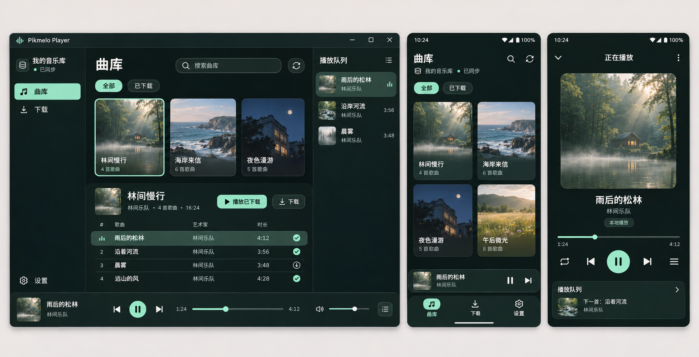
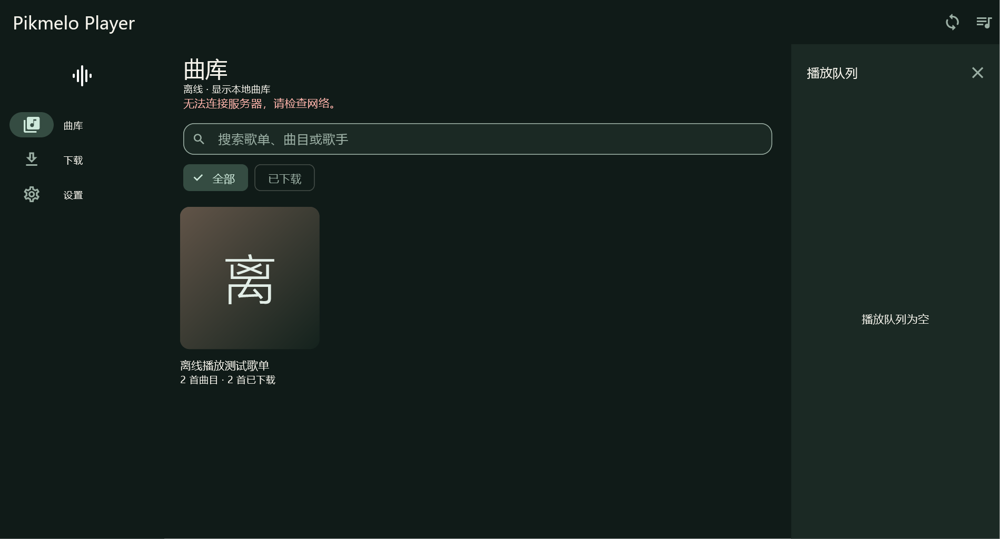
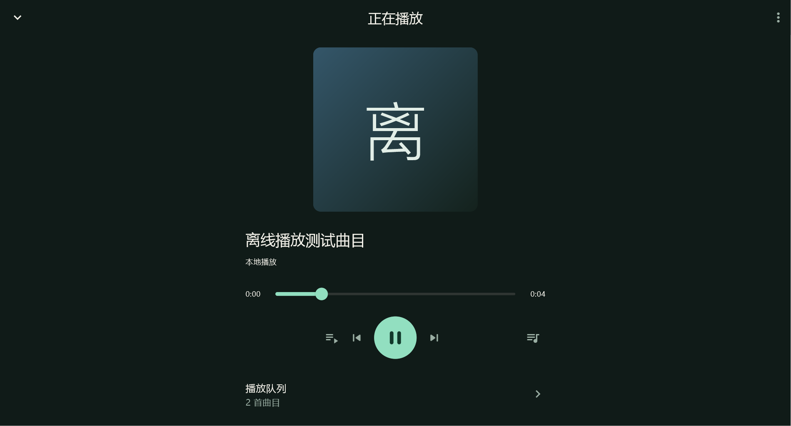
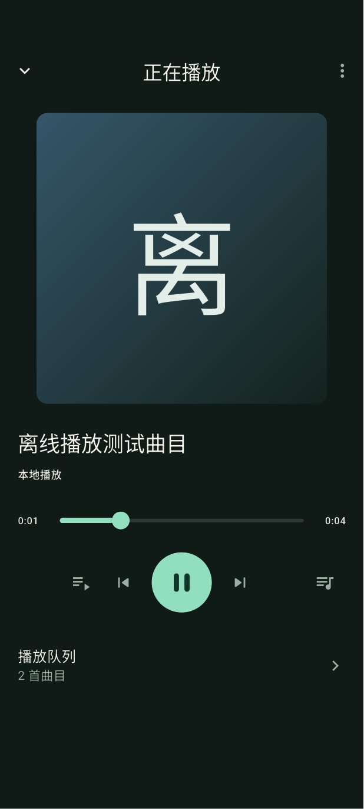

# Pikmelo Player 界面设计 V1

设计日期为 2026-11-12。用户已确认 Android 与 Windows 的界面方向。概念图中的歌单、曲名、封面和时长为演示数据，当前实现与验证结果见下方执行记录。



## 调研与取舍

- Spotify 官方桌面设计说明采用曲库侧栏、主内容区和正在播放视图。借鉴其浏览与播放并行的空间组织，Windows 队列面板可收起，缩窄窗口后作为抽屉展示。[官方设计说明，2023-06-20](https://newsroom.spotify.com/2023-06-20/spotify-desktop-experience-redesign-your-library-now-playing-views-customize/)
- Apple Music 的 Windows 使用手册展示迷你播放器，以及从紧凑播放入口访问播放操作的方式。手机端采用常驻迷你播放栏，点击封面或标题展开完整播放器。[Apple 官方支持](https://support.apple.com/zh-cn/guide/music-windows/mus71d7dcfce/windows)
- Symfonium 官方宣传图展示曲库、音乐源、正在播放和离线文件管理。结合本项目的 API Key 授权与下载流程，把服务器配置放到设置，下载任务与可离线播放的文件分别呈现。官方注明宣传图来自较早版本，本稿参考其功能组织。[官方界面图集](https://docs.symfonium.app/wiki/other/promotional-video-images/)、[官方离线与下载说明](https://docs.symfonium.app/wiki/settings/settings-offline-cache-and-download/)

## 视觉系统

采用深松绿与薄荷色，封面摄影提供主要色彩。保持平整、低反光的内容表面。

| 元素 | 设计值 |
|---|---|
| 页面背景 | #101B18 |
| 提升表面 | #1B2924 |
| 主操作与选中态 | #92DFC0 |
| 主文字 | #F4F2EA |
| 次文字 | #9AAEA3 |
| 错误提示 | #FFB4AB，配合明确文字 |
| 字体 | 中文采用系统无衬线，拉丁字符优先 Instrument Sans，实际接入时评估字体包体 |
| 间距 | 以 8 dp 为基础，手机页边距 20 dp，桌面内容边距 28 dp |
| 圆角 | 封面 8 dp，卡片 16 dp，底部抽屉上边角 24 dp |
| 字号 | 页面标题 28，分区标题 20，正文 15–16，辅助文字 13 sp |
| 操作区域 | 手机触控目标至少 48×48 dp，桌面图标目标至少 32×32 dp |

主操作始终使用薄荷色。下载状态同时使用文字与图标，选中曲目增加背景和播放标记。字体缩放、焦点边框、读屏顺序及颜色对比度在 Flutter 实现时验证。

## Android 页面结构

### 曲库

顶部显示“曲库”、搜索入口与手动同步。标题下方用一行显示服务器别名和同步状态。

“全部 / 已下载”切换当前可见内容。歌单采用双列封面卡片，显示名称和曲目数量。点击进入歌单详情，详情页展示曲目列表、下载状态及“播放已下载”主按钮。

没有完成下载的曲目提供下载操作。首次使用时提供“连接音乐库”入口，进入服务器地址与 API Key 表单。同步失败时保留可用内容并提供重试。

手机底部固定“曲库 / 下载 / 设置”导航。迷你播放栏位于导航上方，显示当前封面、曲名、暂停和下一首，点击标题展开完整播放器。空队列时收起该栏。

### 正在播放

采用独立全屏页面，从上到下呈现返回、封面、曲名与歌手、本地播放状态、进度和主要控制。返回保留当前播放。

主控制为模式、上一首、播放暂停、下一首和队列。点击队列打开底部抽屉，选中当前曲目并允许点击切换。Android 音量主要跟随系统媒体音量，应用音量放在更多操作中，避免首屏控制拥挤。

进度拖动时展示预览时间，松手后定位。下载文件失效或授权变更时，明确展示原因与重新下载或返回曲库的入口。

### 下载

使用“任务 / 已下载”两个页签。任务页展示单曲进度、已下载字节、暂停继续与重试，失败项保留原因。“已下载”页提供播放、本地占用及删除入口。

整首下载完成后更新可播放状态。离线时展示“当前离线，可播放已下载内容”。批量删除采用确认步骤，单曲删除可通过菜单发起并在完成后反馈结果。

### 设置

包含服务器配置与同步、缓存与存储、播放行为、关于与版本。API Key 默认隐藏，连接测试提供明确结果。更换服务器或凭据后的队列与下载状态遵循现有业务规则。

## Windows 页面结构

宽屏采用左侧导航、中央曲库与歌单详情、右侧可收起队列，底部全局播放栏持续显示当前状态。

- 左栏宽度约 208 px，展示品牌、曲库、下载和设置，服务器别名置于底部。
- 中央区域展示曲库搜索、筛选、歌单封面和所选歌单曲目。曲目行提供曲名、歌手、时长、下载状态及更多操作。
- 队列栏宽约 280 px，显示正在播放和后续曲目，支持收起。
- 底部播放栏高约 88–96 px，左侧曲目信息，中间主控制与进度，右侧音量和队列入口。
- 最小化继续播放，关闭窗口退出。现有空格及 Ctrl+方向键操作延续，文本编辑保留输入行为。

建议断点以实际可用内容宽度验证。1200 px 以上展示三栏，840–1199 px 收起队列，600–839 px 收窄导航，600 px 以下采用手机式导航和单列内容。播放栏在窄宽度下合并次要操作，避免控制拥挤。

## 状态与实现边界

| 场景 | 界面反馈 |
|---|---|
| 首次启动 | 连接音乐库入口及简短说明 |
| 同步进行中 | 顶部轻量进度，已有曲库继续显示 |
| 无网络 | 离线提示与已下载筛选入口 |
| 下载中 | 单曲进度、暂停与取消 |
| 下载失败 | 原因与重试 |
| 播放失败 | 播放器内错误说明及可执行操作 |
| 授权变化 | 停止受影响音源，解释可用内容变化 |
| 暂无歌单 | 显示同步或检查授权入口 |

曲库搜索、导航重排、完整播放页和下载页签属于本稿提出的 UI 工作。搜索范围首先限定本地已同步的授权元数据。封面读取需要核对服务器字段和接口，缺少封面时使用歌单名称与固定色块生成占位封面。图中的摄影封面属于视觉示意。

## 落地顺序

- [x] 调研官方界面资料，形成双平台设计方向。
- [x] 整理页面结构、视觉规格与状态说明。
- [x] 生成并检查 Windows 曲库、Android 曲库与完整播放页的高保真概念图。
- [x] 用户确认 V1 设计方向，开始 Flutter 界面实现。
- [x] 接入主题配色、响应式导航和紧凑播放栏。
- [x] 完成歌单详情、完整播放页、队列与下载页。
- [x] 接入歌单、曲目和歌手的本地搜索，以及已下载筛选。
- [x] 检查现有客户端协议模型，使用名称色块封面作为当前占位方案。
- [ ] 服务端封面字段与鉴权接口确认后接入真实封面。
- [x] 执行不同窗口尺寸、1.5 倍文字缩放及键盘回归。
- [ ] 在真机进行 TalkBack 读屏操作验收。
- [ ] 在 Android 真机验收触控、来电、耳机和省电场景。

## Flutter 实现与验证

- 实现深松绿与薄荷色主题，Windows 中文优先使用 Microsoft YaHei，Android 使用系统字体回退。
- 手机底部导航包含曲库、下载和设置，Windows 使用侧栏与宽屏队列面板。连接表单位于设置，连接成功后返回曲库，连接失败时保留输入和错误信息。
- 曲库支持歌单卡片、已下载筛选和本地搜索，搜索曲目与歌手时显示匹配曲目并合并重复结果。歌单页支持批量下载及播放已下载曲目。
- 紧凑播放栏点击曲名展开完整播放页，共用进度与主控制组件。队列组件供桌面侧栏与底部抽屉复用。下载页分为任务与已下载页签，沿用现有暂停、续传、重试与删除逻辑。
- 当前封面为依据名称生成的色块与首字。摄影封面的接入依赖后续确认的封面协议。
- 71 项测试与静态分析通过，新增完整播放页在窄屏、横屏、桌面及 1.5 倍文字缩放下的回归，并扩展搜索、已下载筛选和错误输入用例。
- 最终双平台调试构建通过。Android APK 为 231628250 字节，覆盖安装成功，冷启动耗时 7371 毫秒，错误日志为空。Windows 客户端启动响应正常，窗口关闭后退出码为 0。
- Windows 和 Android 15/API 35 模拟器的原生集成用例通过，覆盖离线数据库重开、曲库进入歌单、播放页展开收起、暂停、定位、切歌和删除播放中的本地文件。测试音量为 0。

以下截图来自 Flutter 原生集成测试，展示测试歌单与生成的 WAV 音源。

### Windows





### Android




## 设计稿生成记录

高保真概念图使用内置 image_gen 生成。图中文字和像素位置用于视觉评审，Flutter 实现以本文规格和实际交互验证为准。

<details>
<summary>生成提示词</summary>

```text
Create a polished high-fidelity UI design board for the Flutter music player "Pikmelo Player". A single cohesive proposed design, flat straight-on crisp UI mockups, landscape high resolution. Place one large Windows application window on the left occupying 60% width, and two Android screens on the right, library and full now-playing, readable typography. Neutral warm pale gray presentation background, very subtle shadows, no perspective, no laptops or hands, no decorative captions or marketing slogans.

Visual style: sophisticated intimate music library, midnight pine #101B18 background, raised surfaces #1B2924, mint #92DFC0 primary controls, warm ivory #F4F2EA text, muted sage #9AAEA3 secondary text. Spacious 8px rhythm, 16px corner radii for surfaces and 8px album artwork. Consistent clean Material rounded line icons. Font Instrument Sans for Latin and clean Chinese sans-serif. Realistic photographic album artwork, hero cover a poetic sunlit misty forest lake with a small cabin, other covers coastal ocean, midnight architecture and golden meadow. Use fictional album and artist titles. No fake badges for lossless, no heart/favorite actions, no lyrics, no streaming services or recommendations.

Windows window: clean title bar "Pikmelo Player" with window controls. Left sidebar brand and navigation with Chinese labels "曲库", "下载", and "设置" at bottom. Current server label "我的音乐库" and tiny status "已同步". Main library content heading "曲库", a compact search input labeled "搜索曲库" and sync icon. Filter tabs "全部" and "已下载". Three album playlist cover cards titled "林间慢行", "海岸来信", "夜色漫游", small count/subtitle. Selected playlist below in clean dense track list with header "林间慢行", primary mint "播放已下载" button and secondary download button. Track rows: "雨后的松林" / "林间乐队", "沿着河流" / "林间乐队", "晨雾" / "林间乐队", "远山的风" / "林间乐队". Durations and small downloaded check-circle or download outline icon as appropriate. Active track row gently mint-tinted. Right queue pane heading "播放队列", current item plus two upcoming tracks, compact cover thumbnails. Fixed bottom player bar spanning the app with thumbnail/title/artist left, centered previous/pause/next and seek line with "1:24" / "4:12", right volume and queue button.

Android library screen: status bar, header "曲库", search and sync icons. Tiny server connection indication "已同步". Filter chips "全部" / "已下载". Two-column large photographic playlist cards "林间慢行", "海岸来信", "夜色漫游", "午后微光" with subtle track counts. A compact one-line mini player above bottom navigation, "雨后的松林" plus tiny cover and pause/next. Three navigation destinations "曲库", "下载", "设置", library selected in mint. Avoid duplicating playback controls on this screen.

Android full player: back/down chevron, centered heading "正在播放", overflow. Large square misty forest lake cover in upper middle, title "雨后的松林", artist "林间乐队", small informative label "本地播放". Seek slider, elapsed "1:24" and total "4:12". Five clear controls: play mode, previous, prominent mint circular pause button, next, queue. Below a compact row "播放队列" with next track. Balanced negative space, reachable thumb controls. Match current song, artwork and seek state across all three mockups. Chinese text must be accurate and crisp. This is a professional implementable product design mockup.
```

</details>

